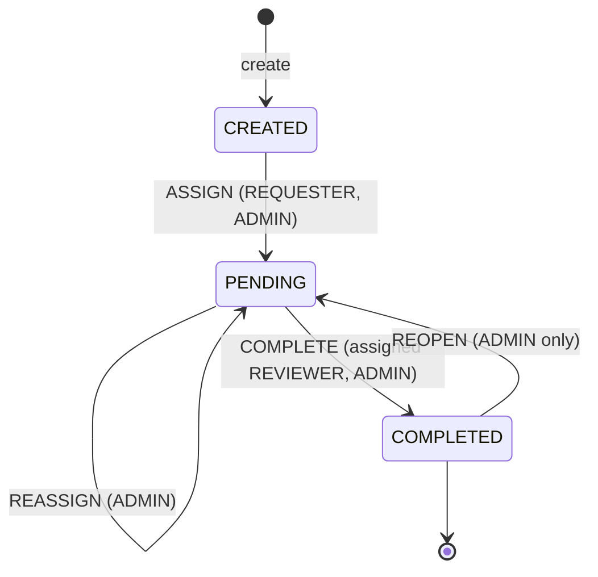

# Workflow Inbox

An internal operations tool where business processes create **actions** that need a human
decision: approve an expense, review a deployment, upload documentation, complete onboarding.
Requesters create actions, reviewers resolve the ones assigned to them, and admins oversee
everything.

Built for the Santex take-home challenge (Option 5, *Workflow Inbox*), as the first iteration
of something a team would keep developing.

Highlights:
- **Data-driven workflow**: states and transitions live in database tables. A new intermediate
  state is a migration, not a code change.
- **Three roles** (`ADMIN`, `REQUESTER`, `REVIEWER`) with explicit permission and visibility rules.
- **Field-level audit log**, written in the same transaction as each change, searchable by admins.
- **Safe under retries and concurrency**: idempotent completion and optimistic locking.
- **Observability**: request IDs in responses, logs and audit rows; transition metrics;
  consistent RFC 9457 errors; optional JSON logs.

---

## Quick start

Requirements: **Java 21**. Nothing else (the Gradle wrapper and an in-memory H2 database are
included).

```bash
./gradlew bootRun        # start on http://localhost:8080
./gradlew test           # run all tests
```

| What | URL |
|---|---|
| Swagger UI | http://localhost:8080/swagger-ui.html |
| OpenAPI document | http://localhost:8080/v3/api-docs |
| Health | http://localhost:8080/actuator/health |
| Metrics | http://localhost:8080/actuator/metrics |
| H2 console | http://localhost:8080/h2-console (JDBC URL `jdbc:h2:mem:workflowinbox`, user `sa`, empty password) |

The database is in memory: every restart begins from the seeded data.

### Seeded users and actions

There is no real authentication (see [Assumptions](#assumptions)). Send the user in the
`X-User-Id` header:

| User | Role |
|---|---|
| `admin` | ADMIN |
| `ana` | REQUESTER |
| `lucia` | REVIEWER |
| `martin` | REVIEWER |

| Id | Type | State | Requested by | Assignee |
|---|---|---|---|---|
| 1 | EXPENSE_APPROVAL | CREATED | ana | |
| 2 | DEPLOYMENT_REVIEW | PENDING | ana | lucia |
| 3 | DOCUMENT_UPLOAD | PENDING | admin | martin |
| 4 | ONBOARDING | COMPLETED (DONE by lucia) | ana | lucia |

The seeded actions come with the audit rows that produced their current state.

---

## Try it

Copy and paste, in order, on a freshly started app. Every command and result below was run
against the application.

```bash
# 1. Ana creates an expense approval assigned to Lucia, and keeps its id
ID=$(curl -s -X POST http://localhost:8080/api/v1/actions \
  -H 'X-User-Id: ana' -H 'Content-Type: application/json' \
  -d '{"type":"EXPENSE_APPROVAL","title":"Travel expense, USD 850","assigneeId":"lucia"}' \
  | sed -E 's/.*"id":([0-9]+).*/\1/')
echo $ID    # 5 on a fresh start

# 2. Lucia's inbox: only actions assigned to her (seeded #2 and the new one), oldest first
curl -s 'http://localhost:8080/api/v1/actions?state=PENDING' -H 'X-User-Id: lucia'

# 3. What Lucia can do with it: [{"code":"COMPLETE","toStateCode":100,"toStateName":"COMPLETED"}]
curl -s http://localhost:8080/api/v1/actions/$ID/transitions -H 'X-User-Id: lucia'

# 4. Lucia approves it: state COMPLETED, completedBy lucia, version 2
curl -s -X POST http://localhost:8080/api/v1/actions/$ID/transitions \
  -H 'X-User-Id: lucia' -H 'Content-Type: application/json' \
  -d '{"transition":"COMPLETE","outcome":"APPROVED","comment":"Within policy"}'

# 5. Same request again (double click, retry): 200, nothing changes, still version 2
curl -s -X POST http://localhost:8080/api/v1/actions/$ID/transitions \
  -H 'X-User-Id: lucia' -H 'Content-Type: application/json' \
  -d '{"transition":"COMPLETE","outcome":"APPROVED","comment":"Within policy"}'

# 6. A different decision now: 409 ACTION_ALREADY_COMPLETED, with outcome, completedBy, completedAt
curl -s -X POST http://localhost:8080/api/v1/actions/$ID/transitions \
  -H 'X-User-Id: lucia' -H 'Content-Type: application/json' \
  -d '{"transition":"COMPLETE","outcome":"REJECTED","comment":"Changed my mind"}'

# 7. Martin is not assigned: for him the action does not exist (404 ACTION_NOT_FOUND, not 403)
curl -s http://localhost:8080/api/v1/actions/$ID -H 'X-User-Id: martin'

# 8. Lucia cannot reopen it: only an admin may leave a final state (403 FORBIDDEN)
curl -s -X POST http://localhost:8080/api/v1/actions/$ID/transitions \
  -H 'X-User-Id: lucia' -H 'Content-Type: application/json' \
  -d '{"transition":"REOPEN","comment":"Wrong decision"}'

# 9. The admin reopens it with a reason: PENDING again, outcome cleared, comment = reason,
#    still assigned to Lucia
curl -s -X POST http://localhost:8080/api/v1/actions/$ID/transitions \
  -H 'X-User-Id: admin' -H 'Content-Type: application/json' \
  -d '{"transition":"REOPEN","comment":"Receipt was missing"}'

# 10. The full history of the action, newest first (9 rows, one per changed field)
curl -s "http://localhost:8080/api/v1/audit?actionId=$ID" -H 'X-User-Id: admin'

# 11. Without X-User-Id: 401 UNAUTHENTICATED
curl -s http://localhost:8080/api/v1/actions

# 12. Transition metrics (COUNT 3: two successes and the rejected conflict above)
curl -s 'http://localhost:8080/actuator/metrics/inbox.transitions?tag=transition:COMPLETE'
```

---

## Workflow

States and transitions are rows in `workflow_state` and `state_transition`, seeded by Flyway:



| Code | Name | Initial | Final |
|---|---|---|---|
| 0 | CREATED | yes | |
| 10 | PENDING | | |
| 100 | COMPLETED | | yes |

State codes are identifiers with gaps, so new states can be inserted (for example
`50 IN_REVIEW`). They are never compared to infer an order: `state_transition` is the only
source of truth for allowed moves.

### Adding a state without code changes

```sql
-- new Flyway migration: src/main/resources/db/migration/V5__add_in_review.sql
INSERT INTO workflow_state (code, name, is_initial, is_final) VALUES (50, 'IN_REVIEW', false, false);
INSERT INTO state_transition (code, from_state, to_state, allowed_role) VALUES
  ('START_REVIEW', 10, 50,  'REVIEWER'),
  ('COMPLETE',     50, 100, 'REVIEWER'),
  ('COMPLETE',     50, 100, 'ADMIN');
```

After a restart, `START_REVIEW` appears in `GET /actions/{id}/transitions`, the inbox accepts
`state=IN_REVIEW`, and `COMPLETE` works from the new state (including its idempotent repeat).
Verified by running the app with exactly this migration. A transition code without its own
handler only changes the state; a new handler class is needed only when a transition has new
side effects.

### Permissions

| Operation | ADMIN | REQUESTER | REVIEWER |
|---|---|---|---|
| Create action | yes | yes | no |
| Assign (`CREATED → PENDING`) | yes | own actions | no |
| Reassign (`PENDING → PENDING`) | yes | no | no |
| Complete (`PENDING → COMPLETED`) | yes | no | if assigned |
| Reopen (`COMPLETED → PENDING`) | yes | no | no |
| View actions | all | created by them | assigned to them |
| Search audit | yes | no | no |

Roles per transition come from the table. "Own actions" and "if assigned" are exactly the
visibility rules, so they are enforced by checking visibility first (404).

### Transition rules

| Transition | Body | Behaviour |
|---|---|---|
| `ASSIGN`, `REASSIGN` | `assigneeId` | Must be an existing `REVIEWER`, different from the current assignee (`422` otherwise) |
| `COMPLETE` | `outcome`, `comment` | Outcome must be valid for the type (below); sets `completedBy` / `completedAt` |
| `REOPEN` | `comment` (the reason) | Reason required; stored as the comment; clears outcome and completion data; keeps the assignee |

| Type | Valid outcomes | Comment |
|---|---|---|
| EXPENSE_APPROVAL | APPROVED, REJECTED | required when rejecting |
| DEPLOYMENT_REVIEW | APPROVED, REJECTED | always required |
| DOCUMENT_UPLOAD | DONE | optional |
| ONBOARDING | DONE | optional |

---

## API

| Method & path | Who | Description |
|---|---|---|
| `POST /api/v1/actions` | REQUESTER, ADMIN | Create: `type`, `title` (1–120), `description?` (≤ 2000), `assigneeId?`. `201` + `Location` |
| `GET /api/v1/actions` | all | Inbox: filters `state` (name, e.g. `PENDING`), `type`, `assigneeId`; visibility rules; oldest first |
| `GET /api/v1/actions/{id}` | all | Action details |
| `GET /api/v1/actions/{id}/transitions` | all | Transitions the caller can apply now |
| `POST /api/v1/actions/{id}/transitions` | per workflow table | `{"transition", "assigneeId"?, "outcome"?, "comment"?}`. `200` with the updated action |
| `GET /api/v1/workflow/states` | all | Configured states |
| `GET /api/v1/workflow/transitions` | all | Configured transitions (one row per allowed role) |
| `GET /api/v1/audit` | ADMIN | Filters `actionId`, `userId`, `from`, `to` (ISO-8601, inclusive); newest first |

- Lists are paginated with `page` (from 0) and `size` (1–100, default 20); out-of-range values
  are a `400`, never silently clamped. Body: `{"items": [...], "page", "size", "totalElements",
  "totalPages"}`.
- An action is `{id, type, title, description, state: {code, name}, requesterId, assigneeId,
  outcome, comment, completedBy, completedAt, createdAt, updatedAt, version}`.
- Timestamps are ISO-8601 UTC strings (`2026-11-26T15:00:27.321405Z`), never numbers.

### Errors

Every error is an RFC 9457 Problem Details document (`application/problem+json`) with a stable
`errorCode` and the `requestId` (same value as the `X-Request-Id` response header). Real
response:

```json
{
  "detail": "Outcome APPROVED is not valid for DOCUMENT_UPLOAD; expected one of [DONE]",
  "status": 422,
  "title": "Unprocessable Content",
  "errorCode": "BUSINESS_RULE_VIOLATION",
  "requestId": "75eecd64-6790-460e-b803-7157fb9d6dbd"
}
```

| HTTP | errorCode | When |
|---|---|---|
| 400 | VALIDATION_FAILED | Invalid body, parameter or JSON; unknown `state`; `from > to`. Includes `fieldErrors: [{field, message}]` |
| 401 | UNAUTHENTICATED | Missing or unknown `X-User-Id` |
| 403 | FORBIDDEN | Role not allowed for the operation or transition |
| 404 | ACTION_NOT_FOUND | Not found **or not visible** to the caller |
| 409 | INVALID_TRANSITION | Transition not defined from the current state |
| 409 | ACTION_ALREADY_COMPLETED | Completing again with a different outcome (includes `outcome`, `completedBy`, `completedAt`) |
| 409 | CONCURRENT_MODIFICATION | Someone else changed the action first |
| 422 | BUSINESS_RULE_VIOLATION | Valid request that breaks a domain rule |
| 500 | INTERNAL_ERROR | Unexpected error: generic message, full details only in the logs |

Errors raised by Spring MVC itself keep their status and get their own codes:
`RESOURCE_NOT_FOUND` (404, no such endpoint), `METHOD_NOT_ALLOWED` (405), `NOT_ACCEPTABLE`
(406), `UNSUPPORTED_MEDIA_TYPE` (415), `REQUEST_NOT_SUPPORTED` (any other 4xx).

---

## Audit log

Every changed field produces one row: action, timestamp (UTC), user, field, old value, new
value, and the request ID that links the row to the logs. Audited fields: `state`, `assignee`,
`outcome`, `comment`. Steps 1 and 4 of [Try it](#try-it) produce:

| action_id | user_id | field | old_value | new_value | request_id |
|---|---|---|---|---|---|
| 5 | ana | state | | CREATED | *(request 1)* |
| 5 | ana | assignee | | lucia | *(request 1)* |
| 5 | ana | state | CREATED | PENDING | *(request 1)* |
| 5 | lucia | state | PENDING | COMPLETED | *(request 4)* |
| 5 | lucia | outcome | | APPROVED | *(request 4)* |
| 5 | lucia | comment | | Within policy | *(request 4)* |

Rejected requests and idempotent repeats write nothing.

```bash
# Lucia's changes in the seeded period: action 4's completion (3 rows)
curl -s 'http://localhost:8080/api/v1/audit?userId=lucia&from=2026-11-18T00:00:00Z&to=2026-11-22T23:59:59Z' \
  -H 'X-User-Id: admin'
```

---

## Design decisions and trade-offs

**Modular monolith, not microservices.** One Spring Boot service with feature packages
(`actions`, `workflow`, `audit`, `users`, `shared`) that talk through interfaces and domain
events, never through another module's repositories (they are package-private). Three tables
do not justify distribution, a single transaction keeps a change and its audit consistent, and
the app runs with one command. The packages are the seams for a future split (see
[Evolution](#evolution-to-microservices)).

**Workflow as data, behaviour as code.** The tables decide *whether* a transition is allowed;
a handler per transition code decides *what else* happens (set assignee, validate outcome,
store the reopen reason). The `workflow` module does not know actions: it works on a
`WorkflowItem` interface that the `Action` entity implements. Rules that must never depend on
the data being right are checked at startup: exactly one initial state, every referenced state
exists, only `ADMIN` can leave a final state, and one transition code never leads to two
different states from the same state. A misconfiguration stops the application with a clear
"APPLICATION FAILED TO START" message instead of failing in production.

**One generic transitions endpoint.** `POST /actions/{id}/transitions` instead of
`/approve`, `/reopen`, etc. That is what lets a new state work without new endpoints. A client
can ask `GET /actions/{id}/transitions` to render only the buttons the user can use.

**Creation always starts in the initial state.** When an assignee is provided, the service
applies `ASSIGN` in the same transaction. No code path bypasses the transition table, the audit
shows both steps, and if the assignment fails (e.g. the assignee is not a reviewer) no action
is created.

**Audit in the same transaction, through domain events.** The actions module publishes an
`ActionChangedEvent`; the audit module consumes it with a synchronous listener that requires an
existing transaction, so a change and its audit commit or roll back together (tested by making
the audit insert fail in the database).
- Not `@TransactionalEventListener(AFTER_COMMIT)`: a failure there leaves a committed change
  without audit, which is exactly the problem an outbox solves in a distributed system.
- Not Hibernate Envers: it stores whole entity revisions instead of field / old value / new
  value rows, and it does not know the business user.

**Idempotent completion.** Repeating the same completion (double click, client retry) returns
`200` and writes nothing. A different decision on an already completed action returns `409`
with who completed it and when. Human decisions are never silently overwritten.

**Optimistic locking.** Two people acting on the same action at the same time: one wins, the
other gets a `409` and reloads, either `CONCURRENT_MODIFICATION` (both read before either
saved) or `ACTION_ALREADY_COMPLETED` (it read after the winner saved). Contention on a single
action is rare, so optimistic locking avoids holding database locks. There is no automatic
retry.

**404 instead of 403 for actions you cannot see.** Otherwise the API would reveal which IDs
exist.

**Identity by header.** The challenge asks not to add authentication. The caller is resolved
from `X-User-Id` behind a `CurrentUserResolver` interface; a JWT-based resolver would replace it
without touching controllers or services (the request ID filter, which logs the claimed user,
would read the token's subject instead).

**H2 + Flyway.** Runs with no installation. Flyway migrations are also the documented way to
evolve the workflow. Hibernate only validates the schema (`ddl-auto=validate`).

More, smaller trade-offs made during the implementation are listed in
[Implementation notes](#implementation-notes-and-smaller-trade-offs).

---

## Observability

- **Request ID**: a safe `X-Request-Id` from the caller is kept, otherwise a UUID is generated.
  It is returned in the response header and in every error body, appears on every log line of
  the request, and is stored in each audit row.
- **Logs**: each line carries the request ID and the user, e.g.
  `INFO ... [manual-1 ana] i.g.e.w.actions.ActionService : Action 5 created (ONBOARDING)`.
  For JSON logs, where `requestId` and `userId` are fields:
  `./gradlew bootRun --args='--spring.profiles.active=json'`.
- **Metrics**: `inbox.transitions` (tags `transition`, `result` = `success` / `rejected` /
  `error`) and `inbox.transition.duration` (tag `transition`).
  ```bash
  curl -s 'http://localhost:8080/actuator/metrics/inbox.transitions?tag=transition:COMPLETE'
  curl -s 'http://localhost:8080/actuator/metrics/inbox.transition.duration'
  ```
- **Health**: `/actuator/health`. Actuator exposes `health`, `info` and `metrics`.

---

## Tests

```bash
./gradlew test     # 153 tests
```

- **Integration tests** (`@SpringBootTest` + MockMvc against the real H2 database and Flyway
  migrations, with real commits): full flows, permissions (401/403/404), invalid transitions,
  business rules, idempotency, reopen, reassign, audit rows and search, request IDs, error
  format, metrics and the OpenAPI document. Tests that change data create their own actions,
  so results do not depend on execution order (also checked by running them in random order).
- **Concurrency**: a real race (two threads complete the same action with different outcomes,
  25 rounds) that asserts only timing-independent invariants, plus a deterministic test that
  forces a stale version and expects `409 CONCURRENT_MODIFICATION`. Run repeatedly, also with
  every CPU busy, without failures.
- **Unit tests**: transition engine, startup validation of the workflow configuration
  (including a misconfigured final-state transition), handler selection, outcome rules per
  type, request ID filter.

---

## Project structure

```
src/main/java/io/github/elmatty18/workflowinbox/
├── actions/    Action entity, ActionType (outcome rules), ActionService, ActionController,
│               DTOs, visibility queries, field-change snapshots, transition metrics
├── workflow/   states, transitions, WorkflowDefinition (loaded and validated at startup),
│               TransitionEngine, transition handlers, startup validator + failure analyzer,
│               /workflow endpoints
├── audit/      audit entity, event listener, search service and endpoint
├── users/      users and roles, CurrentUserResolver (X-User-Id), @CurrentUser,
│               OpenAPI docs for the header
└── shared/     error handling (Problem Details, error codes), domain events, request ID
                filter, pagination, OpenAPI config, Clock
src/main/resources/
├── application.properties          H2, JPA, logging, actuator, springdoc
├── application-json.properties     JSON (ECS) console logs, "json" profile
└── db/migration/                   V1 schema, V2 workflow, V3 users/actions/audit, V4 completion fields
```

---

## Assumptions

- Each user has exactly one role.
- Actions are created through the API by requesters or admins; in a real system other services
  would create them.
- Only users with the `REVIEWER` role can be assignees.
- Reopening clears the previous outcome and replaces the comment with the reason; the old
  decision remains in the audit log.
- Times are stored and returned in UTC.

---

## Time spent and scope

The challenge suggests 60 minutes. This took **TODO hours**.

I chose to go beyond the suggested scope on purpose: TODO (for example, "the role I am applying
for owns a workflow runtime, so I wanted the data-driven state machine, role rules and audit
trail to be part of the conversation instead of only described"). The README and the decisions
above are what I would have delivered in the first hour; the rest is the implementation of that
design.

Built with Claude Code as a pair programmer, from a written specification (`SPEC.md`) that I
reviewed step by step. TODO: keep or adjust this note.

---

## With another day

- **PostgreSQL with Testcontainers** instead of H2, to test against the real database.
- **Real authentication**: JWT from an identity provider, roles from token claims.
- **A small web UI**: accessible inbox and action detail built on the transitions endpoint.
- **Notifications** when an action is assigned or reopened.
- **Due dates and reminders**, and sorting the inbox by them.
- **Audit retention**: partitioning by date or moving it to a separate store as it grows.
- **Contract-first API**: write the OpenAPI document first and generate the interfaces.

---

## Evolution to microservices

```
                 ┌──────────────────────┐   ActionChangedEvent    ┌──────────────┐
  Client ──────► │ Workflow / Actions   │ ── outbox → broker ───► │ Audit        │
                 │ states, transitions  │   (Kafka / RabbitMQ)    │ search       │
                 └──────────┬───────────┘                         └──────────────┘
                            │ validates JWT
                            ▼
                     Identity provider
```

1. Publish `ActionChangedEvent` through a **transactional outbox** to a broker.
2. Move **audit** to its own service first: it grows fastest and is not on the critical path.
   Consumers are idempotent (event ID as key). Trade-off: audit becomes eventually consistent.
3. Replace header identity with **JWTs** from an identity provider.
4. In an orchestration platform, completing an action becomes a **signal to the waiting
   workflow** (for example a human-review node in Temporal), and this inbox becomes the UI for
   those nodes.

---

## Implementation notes and smaller trade-offs

Decisions made while building it. `SPEC.md` has the full reasoning for each.

**API**
- **The API returns some domain records directly.** `/workflow/states`, `/workflow/transitions`
  and `GET /actions/{id}/transitions` serialize the workflow module's records. Less code, but
  the API is coupled to them: changing one of those records is an API change.
- **Unused request fields are ignored, not rejected** (e.g. `outcome` on an `ASSIGN`). A blank
  `assigneeId` or `comment` counts as missing.
- **Reassigning to the current reviewer is a `422`**, because it would change nothing.
- **`COMPLETE` is the only idempotent transition.** It is the human decision a client is most
  likely to retry. Repeating `ASSIGN` or `REOPEN` is a `409 INVALID_TRANSITION` (it no longer
  applies from the new state), and repeating a `REASSIGN` is the `422` above.

**Concurrency**
- **No client-sent version** (`If-Match` or a `version` field). Optimistic locking covers the
  request's own read-and-write window; stale decisions are already prevented by the state
  machine (`COMPLETE` only leaves `PENDING`), so the second decision gets a `409`.
- **No automatic retry** on a version conflict: the caller gets `409 CONCURRENT_MODIFICATION`
  and decides.

**Data**
- **No foreign key from `audit_log` to `action`**, on purpose: the audit module does not depend
  on actions, and the audit table can move to its own service.
- **The workflow definition is loaded and validated once at startup.** States and transitions
  only change through migrations, so adding one needs a restart. In exchange, no transition
  reads the workflow tables.
- **One instant per change.** `completedAt`, `updatedAt` and the audit timestamp of a change are
  the same value: the service takes "now" once and passes it to the engine and handlers, which
  never read a clock. Creating with an assignee is two changes (create, then `ASSIGN`), so it has
  two instants. The clock ticks in microseconds, the database precision, so a value returned
  right after a change equals the one read back later.

**Observability**
- **Metric tags are kept low-cardinality.** The transition code comes from the request body, so
  any code not configured in `state_transition` is recorded as `UNKNOWN`. Metrics are measured
  inside the service, so a failure at commit time would not be counted (writes are flushed
  before the commit, which makes that very unlikely).
- **Errors outside Spring MVC** (in a servlet filter, before the dispatcher) would use Spring
  Boot's default `/error` JSON, without `errorCode` or `requestId`. No such case exists today.
- **JSON logs are opt-in** (`json` profile). The default console stays readable for local work.
- **Logs never contain SQL.** A version conflict is logged as
  `Request rejected: CONCURRENT_MODIFICATION on Action 5`.
