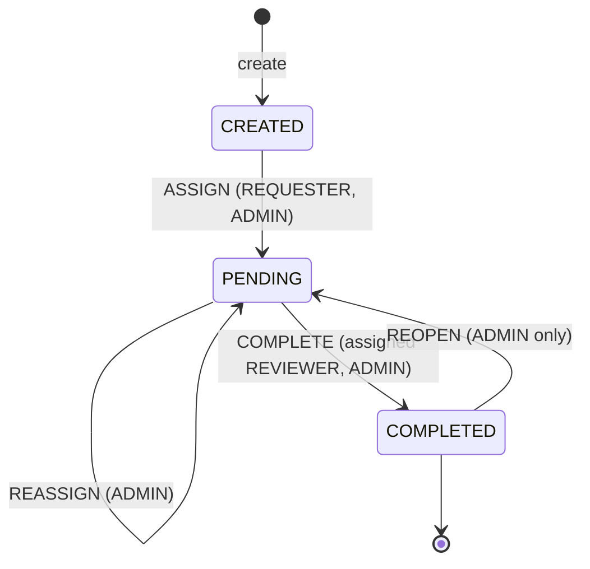

# Workflow Inbox

An internal operations tool where business processes create **actions** that need a human
decision: approve an expense, review a deployment, upload documentation, complete onboarding.
Requesters create actions, reviewers resolve the ones assigned to them, and admins oversee
everything.

Built for the Santex take-home challenge (Option 5, *Workflow Inbox*), as the first iteration
of something a team would keep developing.

Highlights:
- **Data-driven workflow**: states and transitions live in database tables. A new intermediate
  state is a migration, not a code change.
- **Three roles** (`ADMIN`, `REQUESTER`, `REVIEWER`) with explicit permission and visibility rules.
- **Field-level audit log**, written in the same transaction as each change, searchable by admins.
- **Safe under retries and concurrency**: idempotent completion and optimistic locking.
- **Observability**: request IDs, structured logs, metrics, consistent RFC 9457 errors.

---

## Quick start

Requirements: **Java 21**. Nothing else (the Gradle wrapper and an in-memory H2 database are
included).

```bash
./gradlew bootRun        # start on http://localhost:8080
./gradlew test           # run all tests
```

| What | URL |
|---|---|
| Swagger UI | http://localhost:8080/swagger-ui.html |
| OpenAPI document | http://localhost:8080/v3/api-docs |
| Health | http://localhost:8080/actuator/health |
| Metrics | http://localhost:8080/actuator/metrics |
| H2 console | http://localhost:8080/h2-console (JDBC URL: `TODO`) |

The database is in memory: every restart begins from the seeded data.

### Seeded users

There is no real authentication (see [Assumptions](#assumptions)). Send the user in the
`X-User-Id` header:

| User | Role |
|---|---|
| `admin` | ADMIN |
| `ana` | REQUESTER |
| `lucia` | REVIEWER |
| `martin` | REVIEWER |

One example action per type is seeded so the inbox is not empty on startup.

---

## Try it

```bash
# 1. Ana creates an expense approval assigned to Lucia (Location header has the new ID)
curl -i -X POST http://localhost:8080/api/v1/actions \
  -H 'X-User-Id: ana' -H 'Content-Type: application/json' \
  -d '{"type":"EXPENSE_APPROVAL","title":"Travel expense, USD 850","assigneeId":"lucia"}'

ID=<id from the Location header>

# 2. Lucia sees it in her inbox
curl -s 'http://localhost:8080/api/v1/actions?state=PENDING' -H 'X-User-Id: lucia'

# 3. Lucia checks what she can do with it
curl -s http://localhost:8080/api/v1/actions/$ID/transitions -H 'X-User-Id: lucia'

# 4. Lucia approves it
curl -s -X POST http://localhost:8080/api/v1/actions/$ID/transitions \
  -H 'X-User-Id: lucia' -H 'Content-Type: application/json' \
  -d '{"transition":"COMPLETE","outcome":"APPROVED","comment":"Within policy"}'

# 5. Same request again: 200, nothing changes (idempotent)
# 6. A different outcome now: 409 ACTION_ALREADY_COMPLETED
curl -s -X POST http://localhost:8080/api/v1/actions/$ID/transitions \
  -H 'X-User-Id: lucia' -H 'Content-Type: application/json' \
  -d '{"transition":"COMPLETE","outcome":"REJECTED","comment":"Changed my mind"}'

# 7. Only an admin can move it out of a final state
curl -s -X POST http://localhost:8080/api/v1/actions/$ID/transitions \
  -H 'X-User-Id: admin' -H 'Content-Type: application/json' \
  -d '{"transition":"REOPEN","comment":"Receipt was missing"}'

# 8. The admin reviews the full history of the action
curl -s "http://localhost:8080/api/v1/audit?actionId=$ID" -H 'X-User-Id: admin'
```

---

## Workflow

States and transitions are rows in `workflow_state` and `state_transition`, seeded by Flyway:



| Code | Name | Initial | Final |
|---|---|---|---|
| 0 | CREATED | yes | |
| 10 | PENDING | | |
| 100 | COMPLETED | | yes |

State codes are identifiers with gaps, so new states can be inserted (for example
`50 IN_REVIEW`). They are never compared to infer an order: `state_transition` is the only
source of truth for allowed moves.

### Adding a state without code changes

```sql
-- new Flyway migration, e.g. V4__add_in_review.sql
INSERT INTO workflow_state (code, name, is_initial, is_final) VALUES (50, 'IN_REVIEW', false, false);
INSERT INTO state_transition (code, from_state, to_state, allowed_role) VALUES
  ('START_REVIEW', 10, 50, 'REVIEWER'),
  ('COMPLETE',     50, 100, 'REVIEWER');
```

Transitions with a code that has no specific handler only change the state. A new handler class
is needed only when a transition has new side effects.

### Permissions

| Operation | ADMIN | REQUESTER | REVIEWER |
|---|---|---|---|
| Create action | yes | yes | no |
| Assign (`CREATED → PENDING`) | yes | own actions | no |
| Reassign (`PENDING → PENDING`) | yes | no | no |
| Complete (`PENDING → COMPLETED`) | yes | no | if assigned |
| Reopen (`COMPLETED → PENDING`) | yes | no | no |
| View actions | all | created by them | assigned to them |
| Search audit | yes | no | no |

### Completion rules by action type

| Type | Valid outcomes | Comment |
|---|---|---|
| EXPENSE_APPROVAL | APPROVED, REJECTED | required when rejecting |
| DEPLOYMENT_REVIEW | APPROVED, REJECTED | always required |
| DOCUMENT_UPLOAD | DONE | optional |
| ONBOARDING | DONE | optional |

`REOPEN` requires a comment with the reason.

---

## API

| Method & path | Who | Description |
|---|---|---|
| `POST /api/v1/actions` | REQUESTER, ADMIN | Create an action, optionally assigned |
| `GET /api/v1/actions` | all | Inbox: filters `state`, `type`, `assigneeId`; paginated; oldest first |
| `GET /api/v1/actions/{id}` | all | Action details |
| `GET /api/v1/actions/{id}/transitions` | all | Transitions the caller can apply now |
| `POST /api/v1/actions/{id}/transitions` | per workflow table | Apply a transition |
| `GET /api/v1/workflow/states` | all | Configured states |
| `GET /api/v1/workflow/transitions` | all | Configured transitions |
| `GET /api/v1/audit` | ADMIN | Search the audit log: `actionId`, `userId`, `from`, `to`; paginated |

### Errors

Every error is an RFC 9457 Problem Details document with a stable `errorCode` and the
`requestId`:

```json
{
  "type": "about:blank",
  "title": "Unprocessable Entity",
  "status": 422,
  "detail": "Outcome APPROVED is not valid for DOCUMENT_UPLOAD",
  "instance": "/api/v1/actions/3/transitions",
  "errorCode": "BUSINESS_RULE_VIOLATION",
  "requestId": "7f3c9a2e-..."
}
```

| HTTP | errorCode | When |
|---|---|---|
| 400 | VALIDATION_FAILED | Invalid body or query parameters |
| 401 | UNAUTHENTICATED | Missing or unknown `X-User-Id` |
| 403 | FORBIDDEN | Role not allowed |
| 404 | ACTION_NOT_FOUND | Not found **or not visible** to the caller |
| 409 | INVALID_TRANSITION | Transition not available from the current state |
| 409 | ACTION_ALREADY_COMPLETED | Completing again with a different outcome |
| 409 | CONCURRENT_MODIFICATION | Someone else changed the action first |
| 422 | BUSINESS_RULE_VIOLATION | Valid request that breaks a domain rule |
| 500 | INTERNAL_ERROR | Unexpected error (details only in logs) |

---

## Audit log

Every changed field produces one row: action, timestamp (UTC), user, field, old value, new
value, plus the request ID that links the row to the logs. Audited fields: `state`, `assignee`,
`outcome`, `comment`.

| action_id | user_id | field | old_value | new_value |
|---|---|---|---|---|
| 42 | ana | state | | CREATED |
| 42 | ana | assignee | | lucia |
| 42 | ana | state | CREATED | PENDING |
| 42 | lucia | state | PENDING | COMPLETED |
| 42 | lucia | outcome | | APPROVED |

```bash
curl -s 'http://localhost:8080/api/v1/audit?userId=lucia&from=2026-11-01T00:00:00Z&to=2026-11-30T23:59:59Z' \
  -H 'X-User-Id: admin'
```

---

## Design decisions and trade-offs

**Modular monolith, not microservices.** One Spring Boot service with feature packages
(`actions`, `workflow`, `audit`, `users`, `shared`) that talk through interfaces and domain
events. Three tables do not justify distribution, a single transaction keeps a change and its
audit consistent, and the app runs with one command. The packages are the seams for a future
split (see [Evolution](#evolution-to-microservices)).

**Workflow as data, behaviour as code.** The tables decide *whether* a transition is allowed;
a handler per transition code decides *what else* happens (set assignee, validate outcome,
clear fields on reopen). Rules that must never depend on data being correct stay in code and
are checked at startup: exactly one initial state, all referenced states exist, and only
`ADMIN` can leave a final state. A misconfiguration fails fast instead of failing in production.

**One generic transitions endpoint.** `POST /actions/{id}/transitions` instead of
`/approve`, `/reopen`, etc. That is what lets a new state work without new endpoints. A client
can ask `GET /actions/{id}/transitions` to render only the buttons the user can use.

**Creation always starts in the initial state.** When an assignee is provided, the service
applies `ASSIGN` in the same transaction. No code path bypasses the transition table, and the
audit shows both steps.

**Audit in the same transaction, through domain events.** The actions module publishes an
`ActionChangedEvent`; the audit module consumes it with a synchronous listener, so a change and
its audit commit or roll back together.
- Not `@TransactionalEventListener(AFTER_COMMIT)`: a failure there leaves a committed change
  without audit, which is exactly the problem an outbox solves in a distributed system.
- Not Hibernate Envers: it stores whole entity revisions instead of field / old value / new
  value rows, and it does not know the business user.

**Idempotent completion.** Repeating the same completion (double click, client retry) returns
`200` and writes nothing. A different decision on an already completed action returns `409`
with who completed it and when. Human decisions are never silently overwritten.

**Optimistic locking.** Two people acting on the same action at the same time: one wins, the
other gets `409` and reloads. Contention on a single action is rare, so optimistic locking
avoids holding database locks.

**404 instead of 403 for actions you cannot see.** Otherwise the API would reveal which IDs
exist.

**Identity by header.** The challenge asks not to add authentication. The caller is resolved
from `X-User-Id` behind a `CurrentUserResolver` interface; replacing it with JWT validation is
the only change needed for real authentication.

**H2 + Flyway.** Runs with no installation. Flyway migrations are also the documented way to
evolve the workflow. Hibernate only validates the schema (`ddl-auto=validate`).

---

## Observability

- **Request ID**: `X-Request-Id` is propagated or generated, returned in the response, included
  in every log line and stored in each audit row.
- **Logs**: `requestId` and `userId` in the logging context (MDC), cleared after each request.
- **Metrics**: `inbox.transitions` (tags `transition`, `result`) and `inbox.transition.duration`.
  ```bash
  curl 'http://localhost:8080/actuator/metrics/inbox.transitions?tag=transition:COMPLETE'
  ```
- **Health**: `/actuator/health`.

---

## Tests

```bash
./gradlew test
```

- Integration tests against the real H2 database and Flyway migrations: full flows, permissions
  (401/403/404), invalid transitions, business rules, idempotency, reopen, reassign and audit
  search.
- A concurrency test: two simultaneous completions on the same action, exactly one succeeds.
- Unit tests for the transition engine and the startup validation of the workflow
  configuration.

---

## Project structure

```
TODO: paste the final package tree, e.g.
src/main/java/io/github/elmatty18/workflowinbox/
├── actions/     entity, service, controller, DTOs
├── workflow/    states, transitions, engine, handlers, startup validator
├── audit/       audit entity, event listener, search API
├── users/       users, roles, CurrentUserResolver
└── shared/      errors, request ID filter, domain events
src/main/resources/db/migration/   Flyway migrations
```

---

## Assumptions

- Each user has exactly one role.
- Actions are created through the API by requesters or admins; in a real system other services
  would create them.
- Only users with the `REVIEWER` role can be assignees.
- Reopening clears the previous outcome; the old decision remains in the audit log.
- Times are stored and returned in UTC.

---

## Time spent and scope

The challenge suggests 60 minutes. This took **TODO hours**.

I chose to go beyond the suggested scope on purpose: TODO (for example, "the role I am applying
for owns a workflow runtime, so I wanted the data-driven state machine, role rules and audit
trail to be part of the conversation instead of only described"). The README and the decisions
above are what I would have delivered in the first hour; the rest is the implementation of that
design.

Built with Claude Code as a pair programmer, from a written specification (`SPEC.md`) that I
reviewed step by step. TODO: keep or adjust this note.

---

## With another day

- **PostgreSQL with Testcontainers** instead of H2, to test against the real database.
- **Real authentication**: JWT from an identity provider, roles from token claims.
- **A small web UI**: accessible inbox and action detail built on the transitions endpoint.
- **Notifications** when an action is assigned or reopened.
- **Due dates and reminders**, and sorting the inbox by them.
- **Audit retention**: partitioning by date or moving it to a separate store as it grows.
- **Contract-first API**: write the OpenAPI document first and generate the interfaces.

---

## Evolution to microservices

```
                 ┌──────────────────────┐   ActionChangedEvent    ┌──────────────┐
  Client ──────► │ Workflow / Actions   │ ── outbox → broker ───► │ Audit        │
                 │ states, transitions  │   (Kafka / RabbitMQ)    │ search       │
                 └──────────┬───────────┘                         └──────────────┘
                            │ validates JWT
                            ▼
                     Identity provider
```

1. Publish `ActionChangedEvent` through a **transactional outbox** to a broker.
2. Move **audit** to its own service first: it grows fastest and is not on the critical path.
   Consumers are idempotent (event ID as key). Trade-off: audit becomes eventually consistent.
3. Replace header identity with **JWTs** from an identity provider.
4. In an orchestration platform, completing an action becomes a **signal to the waiting
   workflow** (for example a human-review node in Temporal), and this inbox becomes the UI for
   those nodes.
