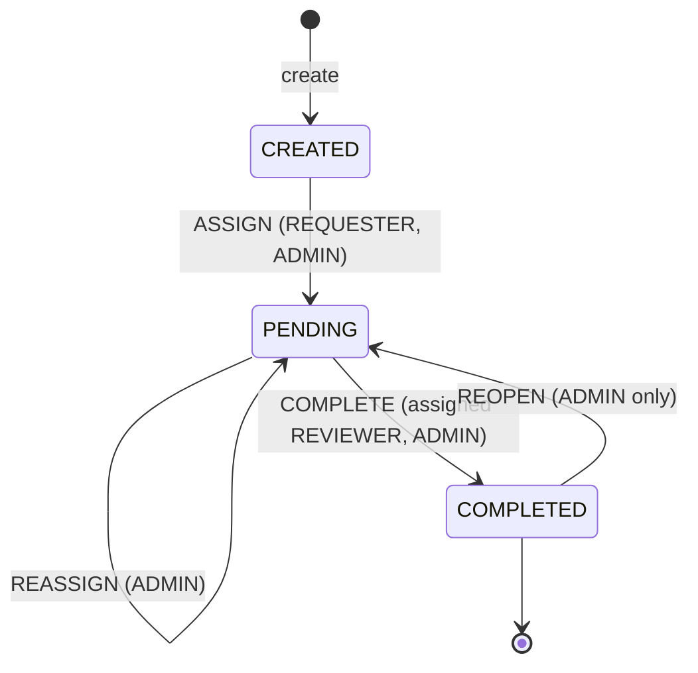

# Workflow Inbox: Implementation Spec

Take-home challenge for Santex (Option 5, "Workflow Inbox"). This document is the single source
of truth for the implementation. The code will be discussed in four interviews, so **clarity of
decisions matters more than feature count**.

## 1. Challenge constraints
- Language: **Java + Spring Boot** (required by the recruiter).
- Deliverables: Git repository + README (how to run, assumptions, trade-offs, what I'd improve
  with another day). Optional 5–10 minute walkthrough video.
- The challenge suggests 60 minutes. This scope is intentionally larger: the README must say how
  long it took and why the scope was extended.
- The challenge asks **not** to add authentication, Docker, CI/CD or Kubernetes just to impress.
- They value: clear API design, maintainable code, project organization, error handling,
  sensible validation, observability (logging, metrics, request IDs), documentation, good
  trade-offs.

## 2. Product
An internal operations tool. Business processes (expenses, deployments, documentation,
onboarding) create **actions** that need a human decision. Requesters create actions, reviewers
resolve the ones assigned to them, admins oversee everything.

- The workflow is **data-driven**: states and allowed transitions live in tables, so new
  intermediate states can be added with a migration, without code changes.
- Every change is recorded in an **audit log**, searchable by admins.

## 3. Tech stack (already generated with Spring Initializr)
- Java 21, **Spring Boot 4.2.0**, Gradle 9.9 (Kotlin DSL) with wrapper.
- Starters already in `build.gradle.kts`: webmvc, validation, data-jpa, actuator, flyway,
  h2console, plus their test starters.
- Spring Boot 4 uses **Jackson 3** (`tools.jackson.*` packages, not `com.fasterxml.jackson.*`).
- H2 in-memory database. Schema and seed data with **Flyway** migrations.
  `spring.jpa.hibernate.ddl-auto=validate`, `spring.jpa.open-in-view=false`.
- **springdoc-openapi** for OpenAPI + Swagger UI: add a version compatible with Spring Boot 4
  (the 2.x line targets Boot 3). Verified: 3.2.1, built on Boot 4.2.0 (see section 12).
- Micrometer through Actuator. Tests: JUnit, Spring Boot Test, MockMvc, AssertJ.
- No Lombok. DTOs are records; entities are regular classes.

## 4. Architecture
**Modular monolith, package by feature**, base package `io.github.elmatty18.workflowinbox`:

| Package | Responsibility |
|---|---|
| `actions` | Action entity, API, use cases |
| `workflow` | States, transitions, transition engine, transition handlers, startup validation |
| `audit` | Audit log entity, event listener, search API |
| `users` | Users, roles, current-user resolution |
| `shared` | Error handling, request ID filter, domain events |

Rules:
- Modules interact through interfaces and **domain events**, never through another module's
  repositories. `audit` must not import `actions` entities.
- Constructor injection only. Business rules live in services/domain classes, not controllers.

Why not microservices: three tables do not justify distribution; a single transaction keeps a
change and its audit consistent; the app runs with one command. The evolution path is documented
in the README (section 12).

## 5. Domain

### Action
| Field | Type | Notes |
|---|---|---|
| `id` | Long | generated |
| `type` | enum | `EXPENSE_APPROVAL`, `DEPLOYMENT_REVIEW`, `DOCUMENT_UPLOAD`, `ONBOARDING` |
| `title` | String | required, 1–120 chars |
| `description` | String | optional, max 2000 chars |
| `stateCode` | int | FK to `workflow_state` |
| `requesterId` | String | user who created it |
| `assigneeId` | String | nullable |
| `outcome` | enum | nullable: `APPROVED`, `REJECTED`, `DONE` |
| `comment` | String | nullable, max 2000 chars |
| `completedBy`, `completedAt` | String, Instant | nullable; set on `COMPLETE`, cleared on `REOPEN`; not audited (derived from `state`/`outcome`); used in the `409 ACTION_ALREADY_COMPLETED` body. Added by migration `V4` |
| `createdAt`, `updatedAt` | Instant | |
| `version` | Long | `@Version` (optimistic locking) |

### Roles and seeded users
Roles: `ADMIN`, `REQUESTER`, `REVIEWER` (one role per user).
Seeded users: `admin` (ADMIN), `ana` (REQUESTER), `lucia` (REVIEWER), `martin` (REVIEWER).
Seed one example action per type, in different states, so the app is usable on startup.
Seeded actions also get the audit rows that would have produced their current state, attributed
to realistic users (e.g. `ana` creates and assigns, `lucia` completes) with `request_id = 'seed'`.

## 6. Data-driven workflow

### States (`workflow_state`)
| code | name | is_initial | is_final |
|---|---|---|---|
| 0 | CREATED | true | false |
| 10 | PENDING | false | false |
| 100 | COMPLETED | false | true |

State codes are **identifiers with gaps**, never compared to infer order. The only source of
truth for allowed moves is `state_transition`.

### Transitions (`state_transition`), one row per role
| code | from | to | allowed_role |
|---|---|---|---|
| ASSIGN | 0 | 10 | REQUESTER |
| ASSIGN | 0 | 10 | ADMIN |
| REASSIGN | 10 | 10 | ADMIN |
| COMPLETE | 10 | 100 | REVIEWER |
| COMPLETE | 10 | 100 | ADMIN |
| REOPEN | 100 | 10 | ADMIN |

Unique constraint on `(code, from_state, to_state, allowed_role)`.

### Transition handlers (Strategy pattern)
The table decides **whether** a transition is allowed. A `TransitionHandler` per code decides
**what else** happens:

| Code | Behaviour |
|---|---|
| ASSIGN / REASSIGN | requires `assigneeId` of an existing user with role `REVIEWER`; sets assignee. Reassigning to the current assignee → `422` |
| COMPLETE | validates outcome for the action type (section 7); sets outcome, comment, `completedBy`, `completedAt` |
| REOPEN | requires `comment` (the reason); stores the reason in `comment`, clears outcome, `completedBy` and `completedAt`, keeps the assignee |
| any other code | generic handler: only changes the state |

So a new intermediate state with a new code (e.g. `START_REVIEW 10 → 50`) needs only migration
rows. Only a transition with new side effects needs a new handler class.

- Handlers are selected by transition code; one handler may serve several codes. Two handlers
  claiming the same code make the application fail to start.
- Request fields a transition does not use (e.g. `outcome` on `ASSIGN`) are **ignored**, not
  rejected.
- The `workflow` module does not depend on `actions`: the engine works on a `WorkflowItem`
  interface that the `Action` entity implements, and the outcome rules of section 7 reach the
  `COMPLETE` handler through a `CompletionPolicy` interface implemented by `ActionType`.
- States and transitions are loaded and validated **once at startup** into an immutable
  in-memory `WorkflowDefinition` (they only change through migrations, which need a restart).
- **One instant per change.** The caller decides "now" once and passes it in:
  `TransitionEngine.apply(item, user, request, Instant occurredAt)` →
  `TransitionHandler.apply(item, request, user, Instant occurredAt)`. Handlers never read a clock
  (e.g. `COMPLETE` sets `completedAt = occurredAt`), so `completedAt`, `updatedAt` and the audit
  `changed_at` of a change are the same instant.

### Startup validation (fail fast)
The application must fail to start, with a clear message, if:
- there is not exactly one initial state,
- a transition references a state that does not exist,
- a transition **from a final state** is allowed for any role other than `ADMIN`,
- the same `(code, from_state)` leads to more than one `to_state` (the engine could not pick a
  target).

All errors are collected and reported together. A Spring Boot `FailureAnalyzer` turns the failure
into the standard "APPLICATION FAILED TO START" description/action message.

### Creation
Creation always starts in the initial state. If the create request includes `assigneeId`, the
service applies `ASSIGN` in the same transaction, so the audit shows both steps and no code path
bypasses the transition table. Create-with-assignee therefore publishes **two**
`ActionChangedEvent`s (creation, then `ASSIGN`); if `ASSIGN` fails (e.g. `422` assignee not a
reviewer) the whole creation rolls back and no action is left behind.

## 7. Business rules
- **Permissions**

| Operation | ADMIN | REQUESTER | REVIEWER |
|---|---|---|---|
| Create action | yes | yes | no |
| Assign (`CREATED → PENDING`) | yes | own actions only | no |
| Reassign (`PENDING → PENDING`) | yes | no | no |
| Complete (`PENDING → COMPLETED`) | yes | no | only if assigned |
| Reopen (`COMPLETED → PENDING`) | yes | no | no |
| View actions | all | created by them | assigned to them |
| Search audit | yes | no | no |

Transition permissions come from the table; visibility is enforced in code. An action that
exists but is not visible returns **404**, not 403, so callers cannot probe which IDs exist.
Ownership ("own actions", "only if assigned") is exactly the visibility rule, so the visibility
check runs first and covers it: there are **no per-transition-code ownership rules**, and a new
transition code gets the same ownership semantics without code changes.

- **Outcome rules on COMPLETE**

| Type | Valid outcomes | Comment |
|---|---|---|
| EXPENSE_APPROVAL | APPROVED, REJECTED | required when REJECTED |
| DEPLOYMENT_REVIEW | APPROVED, REJECTED | always required |
| DOCUMENT_UPLOAD | DONE | optional |
| ONBOARDING | DONE | optional |

- **Idempotent completion**: `COMPLETE` is the **only** idempotent transition, because it is the
  human decision a client is most likely to retry. `COMPLETE` on an already `COMPLETED` action with the **same outcome**
  returns `200` with the current action and writes nothing. A **different** outcome returns
  `409 ACTION_ALREADY_COMPLETED` including who completed it and when.
  There is no `COMPLETE` row from the final state, so this case is handled before the transition
  lookup. Check order for `COMPLETE` on a `COMPLETED` action: visibility (404) → role allowed
  for `COMPLETE` (403) → outcome valid for the type (422) → same outcome `200` / different
  outcome `409 ACTION_ALREADY_COMPLETED`.
- **Concurrency**: optimistic locking. Two concurrent transitions: exactly one succeeds, the
  other gets `409 CONCURRENT_MODIFICATION`. There is **no server-side retry**, so this applies
  even when both requests carry the same outcome; the idempotent `200` only applies to a repeat
  that arrives after the first one committed. (Trade-off, documented in the README.)
- **No client-sent version**: the transitions body does not carry `version` / `If-Match`.
  Optimistic locking protects the request's own read-modify-write window; stale decisions are
  already prevented by the state machine (`COMPLETE` only leaves `PENDING`). (Trade-off,
  documented in the README.)

## 8. Identity (no real authentication)
- Every `/api/**` request is identified by the `X-User-Id` header, resolved against `app_user`.
- Missing header or unknown user → `401 UNAUTHENTICATED`.
- Implemented behind a `CurrentUserResolver` interface, so it can be replaced by JWT validation.
- `/actuator/**`, `/swagger-ui/**`, `/v3/api-docs/**` and the H2 console do not require it.

## 9. API

| Method & path | Who | Description |
|---|---|---|
| `POST /api/v1/actions` | REQUESTER, ADMIN | Create. Body: `type`, `title`, `description?`, `assigneeId?`. `201` + `Location` |
| `GET /api/v1/actions` | all | Inbox. Filters `state` (state **name**, e.g. `PENDING`; unknown name → 400 `VALIDATION_FAILED`), `type`, `assigneeId`; `page`, `size` (max 100); oldest first; visibility rules |
| `GET /api/v1/actions/{id}` | all | Details (state code + name, requester, assignee, outcome, comment, timestamps, version) |
| `GET /api/v1/actions/{id}/transitions` | all | Transitions the current user can apply now (code + target state) |
| `POST /api/v1/actions/{id}/transitions` | per table | Body: `{ "transition": "COMPLETE", "assigneeId"?, "outcome"?, "comment"? }`. `200` with updated action |
| `GET /api/v1/workflow/states` | all | Configured states |
| `GET /api/v1/workflow/transitions` | all | Configured transitions |
| `GET /api/v1/audit` | ADMIN | Filters `actionId`, `userId`, `from`, `to` (ISO-8601 instants, any offset, converted to UTC; inclusive); paginated; newest first (`changedAt` desc, then `id` desc); `from > to` → 400. Items: `{id, actionId, changedAt, userId, field, oldValue, newValue, requestId}` |

One generic transitions endpoint is what lets new states work without new endpoints.

- **Pagination** (`GET /api/v1/actions`, `GET /api/v1/audit`): query params `page` (0-based,
  `>= 0`, default 0) and `size` (1–100, default 20); out-of-range values → `400
  VALIDATION_FAILED` (never silently clamped). Response body:
  `{ "items": [...], "page": 0, "size": 20, "totalElements": 42, "totalPages": 3 }`. Spring's
  `Page` is not serialized directly (its JSON shape is not a stable contract). The inbox sort is
  fixed: `createdAt` ascending, then `id`.
- **Action representation**: `id`, `type`, `title`, `description`, `state: { code, name }`,
  `requesterId`, `assigneeId`, `outcome`, `comment`, `completedBy`, `completedAt`, `createdAt`,
  `updatedAt`, `version`.
- **Time source**: a single `Clock` bean that ticks in **microseconds** (the precision of the
  timestamp columns), so a value returned right after a change equals the one read back later.
- **Timestamps** are always ISO-8601 UTC strings (e.g. `2026-11-26T12:00:00Z`), never numbers,
  including those inside Problem Details.
- The workflow endpoints and `GET /actions/{id}/transitions` return the workflow domain records
  directly. Trade-off (README): the API is coupled to those records; a change to them is an API
  change.

## 10. Errors
RFC 9457 Problem Details (`ProblemDetail`, `application/problem+json`) with extra properties
`errorCode` and `requestId`. Validation errors include a `fieldErrors` list. Never expose stack
traces.

| HTTP | errorCode | When |
|---|---|---|
| 400 | VALIDATION_FAILED | Bean Validation, malformed JSON, invalid query params, `from > to` |
| 401 | UNAUTHENTICATED | Missing or unknown `X-User-Id` |
| 403 | FORBIDDEN | Role not allowed for the operation or transition |
| 404 | ACTION_NOT_FOUND | Not found or not visible to the caller |
| 409 | INVALID_TRANSITION | Transition code not defined from the current state |
| 409 | ACTION_ALREADY_COMPLETED | Completing again with a different outcome |
| 409 | CONCURRENT_MODIFICATION | Optimistic locking conflict |
| 422 | BUSINESS_RULE_VIOLATION | Outcome invalid for type, missing reason/comment, assignee not a reviewer |
| 500 | INTERNAL_ERROR | Unexpected error (logged in full, generic body) |

Protocol-level errors raised by Spring MVC itself (not by the application) use their own codes:

| HTTP | errorCode | When |
|---|---|---|
| 400 | VALIDATION_FAILED | Other framework 400s, e.g. a missing required parameter |
| 404 | RESOURCE_NOT_FOUND | No endpoint for the path |
| 405 | METHOD_NOT_ALLOWED | Path exists, HTTP method not supported |
| 406 | NOT_ACCEPTABLE | Requested response media type not available |
| 415 | UNSUPPORTED_MEDIA_TYPE | Request body media type not supported |
| other 4xx | REQUEST_NOT_SUPPORTED | Any other framework client error |

- `GlobalExceptionHandler` extends `ResponseEntityExceptionHandler`, so these keep their status
  instead of falling into the 500 handler. Every Problem Details response, the application's and
  the framework's, passes through one place that adds `errorCode` and `requestId` (from the MDC;
  same value as the `X-Request-Id` response header).
- Logging: expected errors (`ApiException`, optimistic locking conflict) are one INFO line;
  unexpected ones are logged at ERROR with the stack trace. The `500` body never includes the
  exception message or stack trace: `"An unexpected error occurred. Quote the requestId when
  reporting it."`
- Known limit: errors raised **outside** Spring MVC (in a servlet filter, before the
  `DispatcherServlet`) go through Boot's `/error` with its default JSON, without
  `errorCode`/`requestId`. No such case exists in the application today.

## 11. Audit
Table `audit_log`: `id`, `action_id`, `changed_at` (UTC), `user_id`, `field`, `old_value`,
`new_value`, `request_id`. Indexes on `action_id`, `(user_id, changed_at)` and `changed_at`.
There is deliberately **no foreign key from `audit_log.action_id` to `action`**: it mirrors the
module boundary (audit does not depend on actions) and the evolution path where audit becomes its
own service.

- **One row per changed field**. Audited fields: `state`, `assignee`, `outcome`, `comment`.
  Creation is a `state` change from empty to the initial state. Unchanged fields are not audited.
- The `actions` module publishes `ActionChangedEvent(actionId, userId, List<FieldChange>,
  occurredAt)`; `FieldChange(field, oldValue, newValue)`. Both live in `shared`, so `audit`
  never imports `actions`. Values are text: `state` by name, `outcome` by enum name, empty =
  `null`. Changes are listed in a fixed order (`assignee`, `state`, `outcome`, `comment`), which
  reproduces the example below.
- An idempotent repeat publishes no event (nothing changed).
- The event carries no request id: the listener reads `requestId` from the MDC (set by
  `RequestIdFilter`), which works because it runs synchronously in the request thread.
- `audit` consumes it with a plain synchronous `@EventListener`, which runs **in the same
  transaction**: a change and its audit commit or roll back together. The listener is
  `@Transactional(propagation = MANDATORY)`: publishing the event outside a transaction fails
  instead of writing audit rows without one.
- If the audit write fails, the action change rolls back (tested by making the `audit_log`
  insert fail in the database).
- Deliberately **not** `@TransactionalEventListener(AFTER_COMMIT)` (a failure would leave a
  committed change without audit) and **not** Hibernate Envers (stores whole revisions, not
  field / old / new rows, and does not know the business user).

Example after creating action 42 assigned to `lucia` and completing it:

| action_id | user_id | field | old_value | new_value |
|---|---|---|---|---|
| 42 | ana | state | | CREATED |
| 42 | ana | assignee | | lucia |
| 42 | ana | state | CREATED | PENDING |
| 42 | lucia | state | PENDING | COMPLETED |
| 42 | lucia | outcome | | APPROVED |
| 42 | lucia | comment | | Within policy |

## 12. Observability
- `RequestIdFilter`: reads `X-Request-Id` or generates a UUID, returns it in the response header,
  puts `requestId` and `userId` in the MDC, clears the MDC in `finally`. Runs before every other
  filter.
  - A caller's `X-Request-Id` is kept only if it matches `[A-Za-z0-9._:-]{1,100}` (fits
    `audit_log.request_id` and cannot inject into logs); otherwise a new UUID is generated.
  - `userId` goes into the MDC only if it matches `[A-Za-z0-9._@-]{1,50}`. It is the id the
    caller **claims**, put there before identity is checked (so it also appears on 401 logs).
- **Logs** include the MDC values.
  - Default: Boot's plain console pattern with `logging.pattern.correlation=[%X{requestId:-}
    %X{userId:-}]\ ` → `... [req-42 ana] i.g.e.w.actions.ActionService : Action 5 created`. The
    value ends in an escaped space (`\ `) because Boot trims a plain trailing space, and also an
    escaped ` `.
  - Structured JSON (ECS) with the `json` profile (`application-json.properties`), where
    `requestId` and `userId` become fields. Not the default because it is harder to read locally.
  - INFO lines for: action created, transition applied (`ASSIGN CREATED -> PENDING`), idempotent
    repeat with nothing changed.
- **Metrics** (`actions.TransitionMetrics`): counter `inbox.transitions` tagged `transition` and
  `result`; timer `inbox.transition.duration` tagged `transition`. No high-cardinality tags.
  - `transition` is a code configured in `state_transition`, or `UNKNOWN` for anything else (the
    code comes from the request body, so any string could arrive).
  - `result` is `success`, `rejected` (expected 4xx outcome: `ApiException` or optimistic
    locking conflict) or `error` (unexpected exception).
  - An idempotent repeat counts as `success`; a `404` (not visible) counts as `rejected` for
    that code; the `ASSIGN` applied during create is counted; the timer records every result.
  - Measured inside the service method, so a failure at commit time would not be counted
    (`saveAndFlush` makes that very unlikely).
- Actuator exposes `health`, `info`, `metrics`.
- **OpenAPI / Swagger UI** (springdoc-openapi **3.2.1**, the 3.x line for Boot 4; 3.2.1 is built
  on Boot 4.2.0). Swagger UI at `/swagger-ui.html`, spec at `/v3/api-docs`, both without
  `X-User-Id`.
  - Only `/api/**` is documented (`springdoc.paths-to-match`); springdoc's automatic responses
    per `@ExceptionHandler` are disabled (`springdoc.override-with-generic-response=false`).
  - The `users` module documents its own header: `X-User-Id` (required, header) on every
    operation, and the `@CurrentUser` parameter is hidden.
  - Errors are a `Problem` schema with reusable `components.responses`. `400`, `401` and `500`
    are added to every operation; each endpoint declares its own `403`/`404`/`409`/`422` with
    `@ApiResponse(ref = ...)`.

## 13. Tests
- **Isolation**: integration tests commit for real (no test-managed transaction, so optimistic
  locking and commit-time behaviour are exercised). Any test that changes data creates its own
  actions through the API and never modifies seeded ones; seeded actions are used only by
  read-only tests (visibility, filters, ordering). Results never depend on execution order.
- Integration tests (`@SpringBootTest` + MockMvc, real H2 + Flyway):
  - create with assignee → complete → audit rows present;
  - 401 without header, 403 wrong role, 404 not visible;
  - 409 invalid transition, 422 outcome invalid for type, 422 reopen without reason;
  - idempotent completion (same outcome, no new audit rows) and 409 on conflicting outcome;
  - admin reopens a completed action; reviewer cannot;
  - admin reassigns; requester cannot assign someone else's action;
  - audit search by action, by user and date range; 403 for non-admins; 400 for `from > to`.
- Concurrency test: two simultaneous completions on the same action, exactly one succeeds.
- Unit tests: transition engine and startup configuration validator (including a
  misconfigured final-state transition).

## 14. README (deliverable, in English)
- What it is and how to run it (`./gradlew bootRun`, `./gradlew test`), Swagger UI URL, H2
  console, example `curl` calls per user.
- Assumptions (identity by header, seeded data, one role per user).
- Trade-offs and decisions (modular monolith, data-driven workflow, audit in the same
  transaction, 404 vs 403, idempotent completion, optimistic locking without server-side retry,
  no client-sent version, no FK from audit to actions, only `COMPLETE` is idempotent, unused
  transition fields are ignored, API coupled to the workflow domain records).
- Time spent and why the scope exceeded 60 minutes.
- With another day: PostgreSQL + Testcontainers, JWT authentication, UI, notifications, due dates.
- Evolution to microservices: publish `ActionChangedEvent` through a transactional outbox to a
  broker; move audit to its own service with idempotent consumers (accepting eventual
  consistency); identity provider issuing JWTs; completing an action as a signal to a waiting
  workflow in an orchestration engine (for example a Temporal human-review node).
- State diagram (section 6) and a simple ER diagram.

## 15. Implementation order
1. Flyway migrations (schema, workflow seed, users and actions seed) + application config.
2. Users and `CurrentUserResolver`.
3. Workflow entities, startup validator, transition handlers and engine (+ unit tests).
4. Actions: entity, service, controller (+ integration tests).
5. Audit: event, listener, search endpoint (+ tests), plus the request ID filter (brought forward
   so audit rows get a real `request_id`).
6. Errors (500, `requestId` in Problem Details), logging with MDC, metrics, springdoc.
7. Concurrency test.
8. README.
