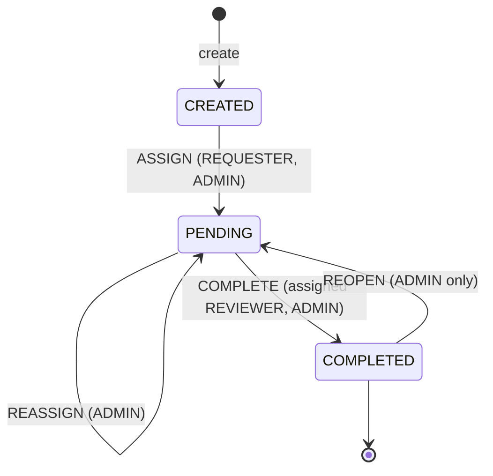

# Workflow Inbox: Implementation Spec

Take-home challenge for Santex (Option 5, "Workflow Inbox"). This document is the single source
of truth for the implementation. The code will be discussed in four interviews, so **clarity of
decisions matters more than feature count**.

## 1. Challenge constraints
- Language: **Java + Spring Boot** (required by the recruiter).
- Deliverables: Git repository + README (how to run, assumptions, trade-offs, what I'd improve
  with another day). Optional 5–10 minute walkthrough video.
- The challenge suggests 60 minutes. This scope is intentionally larger: the README must say how
  long it took and why the scope was extended.
- The challenge asks **not** to add authentication, Docker, CI/CD or Kubernetes just to impress.
- They value: clear API design, maintainable code, project organization, error handling,
  sensible validation, observability (logging, metrics, request IDs), documentation, good
  trade-offs.

## 2. Product
An internal operations tool. Business processes (expenses, deployments, documentation,
onboarding) create **actions** that need a human decision. Requesters create actions, reviewers
resolve the ones assigned to them, admins oversee everything.

- The workflow is **data-driven**: states and allowed transitions live in tables, so new
  intermediate states can be added with a migration, without code changes.
- Every change is recorded in an **audit log**, searchable by admins.

## 3. Tech stack (already generated with Spring Initializr)
- Java 21, **Spring Boot 4.2.0**, Gradle 9.9 (Kotlin DSL) with wrapper.
- Starters already in `build.gradle.kts`: webmvc, validation, data-jpa, actuator, flyway,
  h2console, plus their test starters.
- Spring Boot 4 uses **Jackson 3** (`tools.jackson.*` packages, not `com.fasterxml.jackson.*`).
- H2 in-memory database. Schema and seed data with **Flyway** migrations.
  `spring.jpa.hibernate.ddl-auto=validate`, `spring.jpa.open-in-view=false`.
- **springdoc-openapi** for OpenAPI + Swagger UI: add a version compatible with Spring Boot 4
  (the 2.x line targets Boot 3). Verify compatibility before adding it.
- Micrometer through Actuator. Tests: JUnit, Spring Boot Test, MockMvc, AssertJ.
- No Lombok. DTOs are records; entities are regular classes.

## 4. Architecture
**Modular monolith, package by feature**, base package `io.github.elmatty18.workflowinbox`:

| Package | Responsibility |
|---|---|
| `actions` | Action entity, API, use cases |
| `workflow` | States, transitions, transition engine, transition handlers, startup validation |
| `audit` | Audit log entity, event listener, search API |
| `users` | Users, roles, current-user resolution |
| `shared` | Error handling, request ID filter, domain events |

Rules:
- Modules interact through interfaces and **domain events**, never through another module's
  repositories. `audit` must not import `actions` entities.
- Constructor injection only. Business rules live in services/domain classes, not controllers.

Why not microservices: three tables do not justify distribution; a single transaction keeps a
change and its audit consistent; the app runs with one command. The evolution path is documented
in the README (section 12).

## 5. Domain

### Action
| Field | Type | Notes |
|---|---|---|
| `id` | Long | generated |
| `type` | enum | `EXPENSE_APPROVAL`, `DEPLOYMENT_REVIEW`, `DOCUMENT_UPLOAD`, `ONBOARDING` |
| `title` | String | required, 1–120 chars |
| `description` | String | optional, max 2000 chars |
| `stateCode` | int | FK to `workflow_state` |
| `requesterId` | String | user who created it |
| `assigneeId` | String | nullable |
| `outcome` | enum | nullable: `APPROVED`, `REJECTED`, `DONE` |
| `comment` | String | nullable, max 2000 chars |
| `createdAt`, `updatedAt` | Instant | |
| `version` | Long | `@Version` (optimistic locking) |

### Roles and seeded users
Roles: `ADMIN`, `REQUESTER`, `REVIEWER` (one role per user).
Seeded users: `admin` (ADMIN), `ana` (REQUESTER), `lucia` (REVIEWER), `martin` (REVIEWER).
Seed one example action per type, in different states, so the app is usable on startup.

## 6. Data-driven workflow

### States (`workflow_state`)
| code | name | is_initial | is_final |
|---|---|---|---|
| 0 | CREATED | true | false |
| 10 | PENDING | false | false |
| 100 | COMPLETED | false | true |

State codes are **identifiers with gaps**, never compared to infer order. The only source of
truth for allowed moves is `state_transition`.

### Transitions (`state_transition`), one row per role
| code | from | to | allowed_role |
|---|---|---|---|
| ASSIGN | 0 | 10 | REQUESTER |
| ASSIGN | 0 | 10 | ADMIN |
| REASSIGN | 10 | 10 | ADMIN |
| COMPLETE | 10 | 100 | REVIEWER |
| COMPLETE | 10 | 100 | ADMIN |
| REOPEN | 100 | 10 | ADMIN |

Unique constraint on `(code, from_state, to_state, allowed_role)`.

### Transition handlers (Strategy pattern)
The table decides **whether** a transition is allowed. A `TransitionHandler` per code decides
**what else** happens:

| Code | Behaviour |
|---|---|
| ASSIGN / REASSIGN | requires `assigneeId` of an existing user with role `REVIEWER`; sets assignee |
| COMPLETE | validates outcome for the action type (section 7); sets outcome and comment |
| REOPEN | requires `comment` (the reason); clears outcome and comment |
| any other code | generic handler: only changes the state |

So a new intermediate state with a new code (e.g. `START_REVIEW 10 → 50`) needs only migration
rows. Only a transition with new side effects needs a new handler class.

### Startup validation (fail fast)
The application must fail to start, with a clear message, if:
- there is not exactly one initial state,
- a transition references a state that does not exist,
- a transition **from a final state** is allowed for any role other than `ADMIN`.

### Creation
Creation always starts in the initial state. If the create request includes `assigneeId`, the
service applies `ASSIGN` in the same transaction, so the audit shows both steps and no code path
bypasses the transition table.

## 7. Business rules
- **Permissions**

| Operation | ADMIN | REQUESTER | REVIEWER |
|---|---|---|---|
| Create action | yes | yes | no |
| Assign (`CREATED → PENDING`) | yes | own actions only | no |
| Reassign (`PENDING → PENDING`) | yes | no | no |
| Complete (`PENDING → COMPLETED`) | yes | no | only if assigned |
| Reopen (`COMPLETED → PENDING`) | yes | no | no |
| View actions | all | created by them | assigned to them |
| Search audit | yes | no | no |

Transition permissions come from the table; ownership ("own", "assigned") and visibility are
enforced in code. An action that exists but is not visible returns **404**, not 403, so callers
cannot probe which IDs exist.

- **Outcome rules on COMPLETE**

| Type | Valid outcomes | Comment |
|---|---|---|
| EXPENSE_APPROVAL | APPROVED, REJECTED | required when REJECTED |
| DEPLOYMENT_REVIEW | APPROVED, REJECTED | always required |
| DOCUMENT_UPLOAD | DONE | optional |
| ONBOARDING | DONE | optional |

- **Idempotent completion**: `COMPLETE` on an already `COMPLETED` action with the **same outcome**
  returns `200` with the current action and writes nothing. A **different** outcome returns
  `409 ACTION_ALREADY_COMPLETED` including who completed it and when.
- **Concurrency**: optimistic locking. Two concurrent transitions: exactly one succeeds, the
  other gets `409 CONCURRENT_MODIFICATION` (unless it is an idempotent repeat).

## 8. Identity (no real authentication)
- Every `/api/**` request is identified by the `X-User-Id` header, resolved against `app_user`.
- Missing header or unknown user → `401 UNAUTHENTICATED`.
- Implemented behind a `CurrentUserResolver` interface, so it can be replaced by JWT validation.
- `/actuator/**`, `/swagger-ui/**`, `/v3/api-docs/**` and the H2 console do not require it.

## 9. API

| Method & path | Who | Description |
|---|---|---|
| `POST /api/v1/actions` | REQUESTER, ADMIN | Create. Body: `type`, `title`, `description?`, `assigneeId?`. `201` + `Location` |
| `GET /api/v1/actions` | all | Inbox. Filters `state`, `type`, `assigneeId`; `page`, `size` (max 100); oldest first; visibility rules |
| `GET /api/v1/actions/{id}` | all | Details (state code + name, requester, assignee, outcome, comment, timestamps, version) |
| `GET /api/v1/actions/{id}/transitions` | all | Transitions the current user can apply now (code + target state) |
| `POST /api/v1/actions/{id}/transitions` | per table | Body: `{ "transition": "COMPLETE", "assigneeId"?, "outcome"?, "comment"? }`. `200` with updated action |
| `GET /api/v1/workflow/states` | all | Configured states |
| `GET /api/v1/workflow/transitions` | all | Configured transitions |
| `GET /api/v1/audit` | ADMIN | Filters `actionId`, `userId`, `from`, `to` (ISO-8601, inclusive); paginated; newest first; `from > to` → 400 |

One generic transitions endpoint is what lets new states work without new endpoints.

## 10. Errors
RFC 9457 Problem Details (`ProblemDetail`, `application/problem+json`) with extra properties
`errorCode` and `requestId`. Validation errors include a `fieldErrors` list. Never expose stack
traces.

| HTTP | errorCode | When |
|---|---|---|
| 400 | VALIDATION_FAILED | Bean Validation, malformed JSON, invalid query params, `from > to` |
| 401 | UNAUTHENTICATED | Missing or unknown `X-User-Id` |
| 403 | FORBIDDEN | Role not allowed for the operation or transition |
| 404 | ACTION_NOT_FOUND | Not found or not visible to the caller |
| 409 | INVALID_TRANSITION | Transition code not defined from the current state |
| 409 | ACTION_ALREADY_COMPLETED | Completing again with a different outcome |
| 409 | CONCURRENT_MODIFICATION | Optimistic locking conflict |
| 422 | BUSINESS_RULE_VIOLATION | Outcome invalid for type, missing reason/comment, assignee not a reviewer |
| 500 | INTERNAL_ERROR | Unexpected error (logged in full, generic body) |

## 11. Audit
Table `audit_log`: `id`, `action_id`, `changed_at` (UTC), `user_id`, `field`, `old_value`,
`new_value`, `request_id`. Indexes on `action_id`, `(user_id, changed_at)` and `changed_at`.

- **One row per changed field**. Audited fields: `state`, `assignee`, `outcome`, `comment`.
  Creation is a `state` change from empty to the initial state. Unchanged fields are not audited.
- The `actions` module publishes `ActionChangedEvent(actionId, userId, List<FieldChange>,
  occurredAt)`; `FieldChange(field, oldValue, newValue)`.
- `audit` consumes it with a plain synchronous `@EventListener`, which runs **in the same
  transaction**: a change and its audit commit or roll back together.
- Deliberately **not** `@TransactionalEventListener(AFTER_COMMIT)` (a failure would leave a
  committed change without audit) and **not** Hibernate Envers (stores whole revisions, not
  field / old / new rows, and does not know the business user).

Example after creating action 42 assigned to `lucia` and completing it:

| action_id | user_id | field | old_value | new_value |
|---|---|---|---|---|
| 42 | ana | state | | CREATED |
| 42 | ana | assignee | | lucia |
| 42 | ana | state | CREATED | PENDING |
| 42 | lucia | state | PENDING | COMPLETED |
| 42 | lucia | outcome | | APPROVED |
| 42 | lucia | comment | | Within policy |

## 12. Observability
- `RequestIdFilter`: reads `X-Request-Id` or generates a UUID, returns it in the response header,
  puts `requestId` and `userId` in the MDC, clears the MDC in `finally`.
- Logs include the MDC values (structured console logging if available in Boot 4).
- Metrics: counter `inbox.transitions` tagged `transition` and `result` (`success`/`rejected`);
  timer `inbox.transition.duration` tagged `transition`. No high-cardinality tags.
- Actuator exposes `health`, `info`, `metrics`.
- Swagger UI documents the `X-User-Id` header and error responses.

## 13. Tests
- Integration tests (`@SpringBootTest` + MockMvc, real H2 + Flyway):
  - create with assignee → complete → audit rows present;
  - 401 without header, 403 wrong role, 404 not visible;
  - 409 invalid transition, 422 outcome invalid for type, 422 reopen without reason;
  - idempotent completion (same outcome, no new audit rows) and 409 on conflicting outcome;
  - admin reopens a completed action; reviewer cannot;
  - admin reassigns; requester cannot assign someone else's action;
  - audit search by action, by user and date range; 403 for non-admins; 400 for `from > to`.
- Concurrency test: two simultaneous completions on the same action, exactly one succeeds.
- Unit tests: transition engine and startup configuration validator (including a
  misconfigured final-state transition).

## 14. README (deliverable, in English)
- What it is and how to run it (`./gradlew bootRun`, `./gradlew test`), Swagger UI URL, H2
  console, example `curl` calls per user.
- Assumptions (identity by header, seeded data, one role per user).
- Trade-offs and decisions (modular monolith, data-driven workflow, audit in the same
  transaction, 404 vs 403, idempotent completion, optimistic locking).
- Time spent and why the scope exceeded 60 minutes.
- With another day: PostgreSQL + Testcontainers, JWT authentication, UI, notifications, due dates.
- Evolution to microservices: publish `ActionChangedEvent` through a transactional outbox to a
  broker; move audit to its own service with idempotent consumers (accepting eventual
  consistency); identity provider issuing JWTs; completing an action as a signal to a waiting
  workflow in an orchestration engine (for example a Temporal human-review node).
- State diagram (section 6) and a simple ER diagram.

## 15. Implementation order
1. Flyway migrations (schema, workflow seed, users and actions seed) + application config.
2. Users and `CurrentUserResolver`.
3. Workflow entities, startup validator, transition handlers and engine (+ unit tests).
4. Actions: entity, service, controller (+ integration tests).
5. Audit: event, listener, search endpoint (+ tests).
6. Errors, request ID filter, metrics, springdoc.
7. Concurrency test.
8. README.
